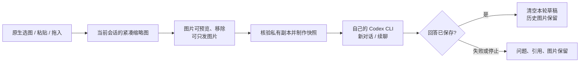

# NoteGlow for Visual Studio Code

**彩色 Markdown · 图片与紧凑多选区引用 · 本机 Codex 对话**

免费 MIT 社区扩展，作者 david yang。独立于 OpenAI、Microsoft 和 Obsidian；Codex 模型调用按使用者自己的账号权限和用量计算。

## 使用

安装 NoteGlow，打开本机文件夹工作区，在 Markdown 中选择文字。右键 **NoteGlow**、编辑器标题栏、选区 CodeLens、侧栏工具栏均可操作；快捷键 `Cmd+Alt+A`（Windows/Linux `Ctrl+Alt+A`）添加选区，`Cmd/Ctrl+Alt+B` 加粗、`Cmd/Ctrl+Alt+I` 斜体。这里使用 VS Code 稳定公开接口，不注入 Trae 式选区浮层。

- 字体色与背景色主按钮直接应用上次颜色；旁边小箭头选择预设色或输入一个 `#RGB` / `#RRGGBB`，例如 `#fff88f`。提交时整体校验，不接受多个颜色或分隔符。清除仅作用于选区的前景和背景。
- 加粗、斜体、行内代码与便携颜色共用 Markdown 结构保护。单个连续选区；未知 HTML、公式等受保护结构会拒绝操作。成功静默，只有失败提醒。原生 Undo/Redo 保留。
- 选区与整个文件可反复添加为紧凑卡片，点击预览、×移除；问题框独立。最多 30 个引用、合计 50,000 UTF-16 单元，问题另限 50,000 单元。引用是添加时的快照。
- 新建、切换、删除对话；每个对话有自己的草稿、引用和模型。模型下拉读取本机 Codex 的 `models_cache.json`；缺失时使用 CLI 默认，并保留历史模型，不假定缓存代表当前账户可用权限。
- 命令 **NoteGlow: 使用绿豆色主题** 由用户主动启用配套主题；**恢复之前的主题** 仅在当前仍为 NoteGlow 主题时恢复，不在安装时改变全局颜色。

示例：[NoteGlow-demo.md](examples/NoteGlow-demo.md)。源码编辑器保留原生 Markdown 标记，通过编辑器装饰显示颜色；**VS Code 自带 Markdown 预览**显示颜色并保留代码语法高亮。不会降低预览安全设置。

0.3.0 同步了 NoteGlow 的原生格式：加粗、斜体、行内代码和代码块着色均保留 Markdown，不再生成格式 HTML 标签。源码视图仍可见 Markdown 标记和独立的颜色记录注释；它不是 Obsidian 的实时预览编辑器。颜色选择后直接应用，格式与双颜色可叠加，取消加粗或斜体保留另一层格式。

## 图片对话（0.2.0）

点击侧栏 **＋图片** 或命令 **NoteGlow: 添加图片到 Codex**，也可把图片粘贴到问题框、拖入侧栏。支持 PNG、JPEG、静态 WebP；**每条消息最多 10 张，单张 10 MiB，合计 20 MiB，单图 3200 万像素且单边不超过 16384**。数量与字节额度独立于文字引用。一次批次中任意图片格式或预算不合法，整批拒绝，不添加部分卡片。

附件区有固定高度和滚动条，显示 `10/10` 计数，问题框始终独立。缩略图延迟加载，点击用 VS Code 原生图片预览；×只移除草稿引用。无文字时使用“请分析附加图片。”发送；新对话与续聊都会把图片交给 CLI。模型是否支持图片由使用者自己的模型服务决定；不支持时保留草稿并提示失败。

图片复制到当前工作区的扩展私有存储 `image-attachments/`，随机文件名，目录 0700、文件 0600（系统支持时）。JSON 仅记录安全文件名、尺寸、摘要及展示名；不保存原图绝对路径或 Base64，不把图片写入笔记或上传到扩展作者的服务。粘贴/拖入仅临时传输有界编码，Webview 不能指定任意本机路径。每轮发送前再次核验文件头、尺寸、SHA-256、普通文件及符号链接边界，再使用本轮独立临时快照；成功、失败和取消都会尝试删除快照。进程强杀或磁盘错误可能留下临时文件，不承诺跨文件事务。

旧 `sessions-v1.json` 没有图片字段时正常读取；字段存在却损坏则停止写入并保留原文件。切换、重载可恢复各自图片草稿与历史。缓存缺失或被修改会阻止预览/发送，请重新添加；头部校验不能证明完整图像解码有效，无法解码时显示占位提示。只删除对话/卡片不会自动删除图片缓存，本版没有后台 GC，防止误删历史共用副本。导入保存失败会补偿清理本批确定未被引用的副本；若落盘与回滚均失败，宁可保留缓存供恢复。大量历史和大尺寸图片的内存/延迟没有压测。

## Codex 与权限

先安装官方 Codex CLI，并在本机自行登录。路径默认 `codex`，可在用户设置 `noteglow.codexPath` 指定一个可执行文件路径，不接受命令参数或 shell 表达式。扩展不会读取、打包或上传 `auth.json`、token 或维护者登录信息。

默认 **read-only / 自动审批关闭**。需要 Codex 改笔记时，可主动在用户设置选择 `noteglow.sandboxMode: workspace-write`；`noteglow.approveForMe` 控制该模式下的 Codex 自动审核。设置仅应用当前执行，仍受 CLI 与操作系统约束；根目录并不等于绝对文件系统隔离。

仅支持桌面本机、磁盘文件夹；CLI 必须运行于已信任的工作区。Remote SSH、WSL、容器、浏览器版、无文件夹和虚拟 URI 不启动本机 CLI。每个对话固定一个工作区根目录，文件引用核验 realpath，禁止跨根或符号链接逃逸。

扩展使用独立 argv 与 stdin 启动 CLI，没有模型代理后台；CLI 继承其自身环境、配置、提供商和 MCP。发送内容可能离开本机进入这些服务；JSON 引用封装不是强制提示词隔离。单次请求设计上限为 10 分钟、累计标准输出 4 MB、未分行缓冲 1,000,000 字符，超限先终止再释放请求锁。这些是保护门限，不是性能基准或响应承诺。

停止使用 SIGTERM，2 秒后仍存活则 SIGKILL；**停止不会撤销已经发生的文件修改**。没有自动重试或恰好一次保证。用户消息先保存，CLI 回答保存后才清草稿；失败保留问题和引用。若回答保存失败，先核对历史和文件再重发。运行中禁止切换、删除或修改草稿。

## Markdown 兼容与本地数据

颜色范围与精确原文快照保存在块后的 `noteglow-text-colors:1` / `noteglow-code-colors:1` 注释，兼容支持该格式的 NoteGlow Obsidian 版本。支持顶层段落、标题、完整列表及行内代码和顶层完整围栏；跨块、引用、表格、列表内代码、未知 HTML 等不能安全映射的结构会拒绝操作。禁用扩展或换用其他阅读器后，普通 Markdown 仍可读，自定义颜色需要相应插件支持。

普通键入、外部改写使快照与正文不一致时，只暂停受影响块的自定义颜色；插件不会异步改写文件或插入额外撤销步骤。撤销回到精确原文会恢复颜色。要在改写后的块重新着色，可先执行 **NoteGlow: 重置当前笔记颜色记录**，该命令会备份当前笔记并清除其自有颜色记录，再重新选择文字着色。

旧版着色 HTML 先执行 **NoteGlow: 恢复当前笔记原生格式**。转换完整预检后，在当前工作区扩展私有存储的 `native-format-backups/` 保存并核验原文备份，再一次编辑转换当前笔记；未知结构或快照冲突会拒绝，绝不批量扫描工作区。成功提示包含备份路径；这些备份含笔记正文，请保留在本机。重复转换没有额外修改。

编辑前核验文档 URI、版本和全文，一次原生编辑事务后保存并读回。保存冲突不盲目回滚后续输入。格式修改仅支持 UTF-8（可带 BOM），其他编码请先转换。单篇上限 1,000,000 UTF-16 单元；同步解析，未做延迟或大文件性能承诺。

会话、模型选择、引用和颜色偏好保存在 VS Code 工作区私有存储，沿用 VS Code 的稳定工作区隔离（增删根目录不会重置历史），不使用 Settings Sync；文件权限 0600（受系统支持），串行快照经同目录临时文件 rename，保存后读回。最多 100 个对话，每个最多 500 条消息。损坏或未知版本存储停止写入，保留原文件。实例级队列不提供跨进程锁或跨设备一致性。卸载不会修改笔记原文；聊天存储含所选私密内容，请按本机数据保护。

## 开发与验证

Node.js 22，`npm ci --ignore-scripts`，`npm run build`，`npm run package`。普通单测和覆盖率仅由 GitHub Actions 执行；`npm run test:coverage` 遍历全部单测，`xvfb-run -a npm run test:integration` 使用官方 Extension Host 验证激活、命令、颜色、磁盘保存、原生撤销与预览。真实模型调用不在 CI 中运行，不上传个人 Codex 认证。

图片特性以 0.1.0 的 `78bd321` 为基线：新增图片校验、传输、缓存、控制器及新增执行分支为新代码，目标 line/statement/branch 各 95%（99% 为拓展目标）；旧模块修改按风险回归。Node 原生覆盖率只报告已加载源文件、没有独立 statement 指标，整仓数值不能证明图片新代码目标，也不能用纯函数测试代替原生界面验收。实际结果以准确 Git SHA 的 CI 为准。首版 Windows/Linux 与 Remote 行为只按明确支持范围报告。

发布 VSIX 采用白名单：程序 bundle、媒体、主题、示例、README 与许可证，不含源码测试、开发依赖、认证或聊天。来源和修改边界见 [UPSTREAM.md](UPSTREAM.md)，完整许可证见 [THIRD_PARTY_NOTICES.txt](THIRD_PARTY_NOTICES.txt)。

反馈：[GitHub Issues](https://github.com/David2007/noteglow-vscode/issues) · 联系：xting.yang@gmail.com
